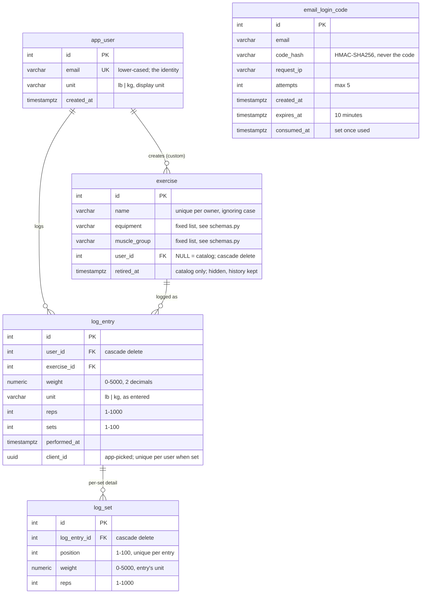

# Database

Postgres on Neon. The schema is owned by Alembic migrations in
`backend/migrations/versions/`, with matching SQLAlchemy models in `backend/app/models.py`.
Update this page in the same change as any migration.

## Notes

- **app_user**: created on first successful sign-in. No name or password is stored.
- **email_login_code**: not linked to `app_user`, because a code can be requested before the
  account exists. Rows older than a day are deleted whenever a new code is requested. The same
  table backs the rate limits (3 per address per 15 minutes, 10 per day, 10 per IP per hour).
- **exercise**: two kinds in one table so log entries point at either the same way.
  - *Catalog* (`user_id` NULL): the shared list, managed from `backend/catalog/exercises.csv` with
    `python -m app.catalog --apply` (see `backend/catalog/README.md`). Removing a row sets
    `retired_at` instead of deleting, so history survives; renames go through `renames.csv`.
    Migration `0001` seeded the first 86 rows.
  - *Custom* (`user_id` set): made by one user and visible only to them. Deleting one deletes
    its log entries too (the API does both in one transaction; the foreign key itself doesn't
    cascade, so a catalog exercise with history can never be deleted by accident).
  - Unique names: partial indexes `exercise_catalog_name` on `lower(name)` for the catalog and
    `exercise_user_name` on `(user_id, lower(name))` for custom ones. A custom exercise may share
    a catalog name.
- **log_entry**: one row per logged exercise, as weight × reps × sets. The weight keeps the unit
  it was entered in, so switching the display unit never rewrites history; the app converts for
  charts. Index `(user_id, exercise_id, performed_at)` serves the history, chart and "last time"
  queries. `client_id` (migration `0005`) is a UUID the app picks for each new entry; a partial
  unique index on `(user_id, client_id)` means a retried request from the offline queue returns
  the entry already saved instead of logging it twice. Older entries have none.
- **Roles** (migration `0004`): the API connects as `overloader_app`, which can select, insert,
  update and delete rows in the app's tables and use their sequences, and nothing else (no schema
  changes, no `alembic_version`). Later tables get the same grants through default privileges.
  Migrations and the catalog sync run as the owner (`neondb_owner`). The role is created without a
  password; it's set per database with `\password overloader_app` (see `infra/README.md`).
- **log_set** (migration `0003`): per-set detail. A *quick* entry has no rows here (every set is
  the same weight × reps). A *per-set* entry has one row per set, and its `log_entry` weight /
  reps / sets become a summary the API maintains: the heaviest set's weight and reps (the first
  one if several tie) and the number of sets. Charts and records use the sets themselves (top
  weight, best est. 1RM of any set, volume summed over sets).
