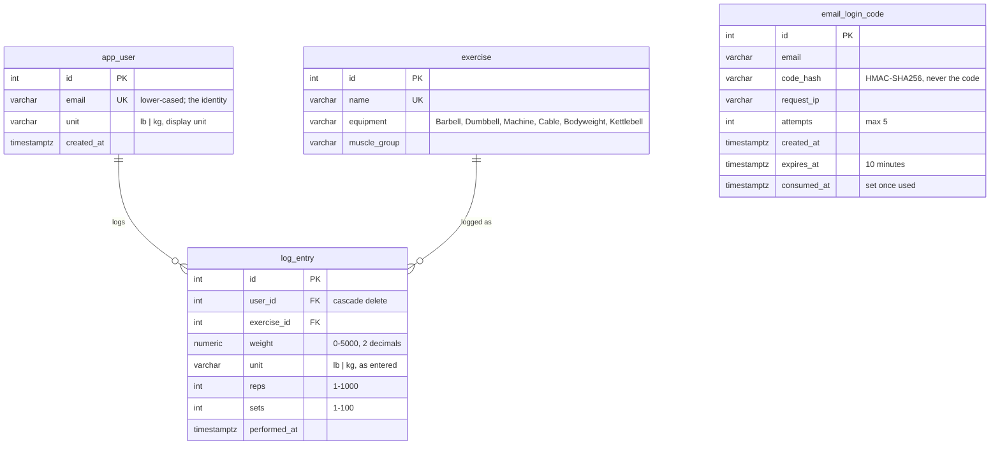

# Database

Postgres on Neon. The schema is owned by Alembic migrations in
`backend/migrations/versions/`, with matching SQLAlchemy models in `backend/app/models.py`.
Update this page in the same change as any migration.

## Notes

- **app_user**: created on first successful sign-in. No name or password is stored.
- **email_login_code**: not linked to `app_user`, because a code can be requested before the
  account exists. Rows older than a day are deleted whenever a new code is requested. The same
  table backs the rate limits (3 per address per 15 minutes, 10 per day, 10 per IP per hour).
- **exercise**: the shared catalog, seeded in migration `0001` (87 rows). Add exercises with a
  new migration so every environment gets them.
- **log_entry**: one row per logged exercise, as weight × reps × sets. The weight keeps the unit
  it was entered in, so switching the display unit never rewrites history; the app converts for
  charts. Index `(user_id, exercise_id, performed_at)` serves the history, chart and "last time"
  queries.
